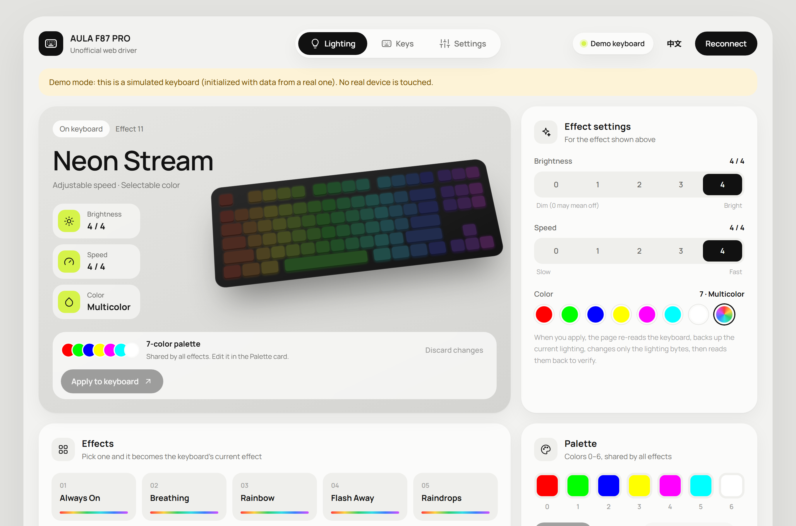
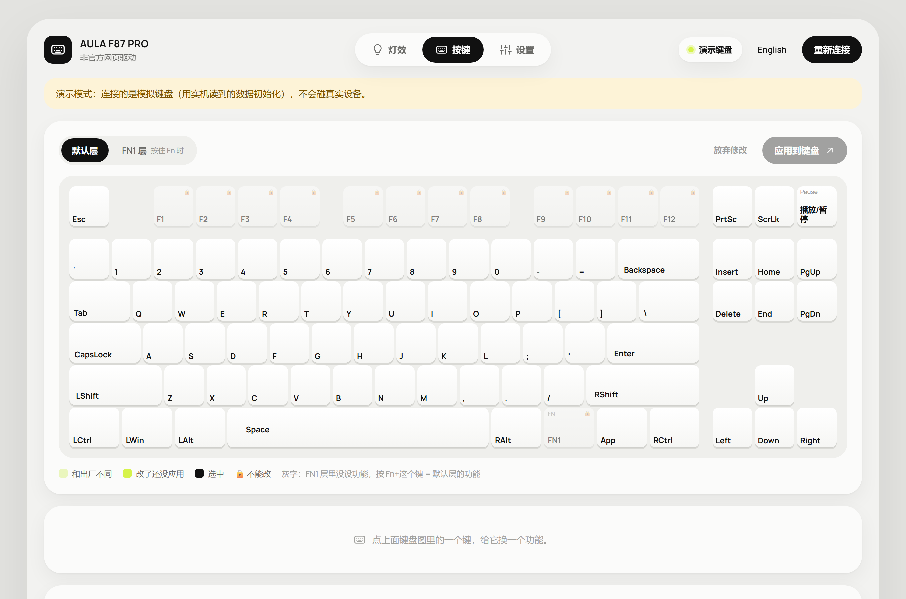

# F87 PRO Web Driver

**English** · [中文](#中文)

An unofficial, open-source web driver for the **AULA F87 PRO** keyboard. It runs in Chrome or Edge using WebHID, so there's nothing to install. Plug in the keyboard, open the page, and change lighting, key mappings and settings.

The official driver is no longer maintained, so I reverse-engineered the configuration protocol and built a cleaner, safer replacement.

**[Open the driver](https://roserrosie.github.io/f87pro-web-driver/)** · **[Try the demo (no keyboard needed)](https://roserrosie.github.io/f87pro-web-driver/driver/?demo=1)**

## Features

- **Lighting**: 14 effects, plus brightness, speed and color for each effect
- **Palette**: customize the 7 colors that all effects share
- **Key remapping** on the default layer and the FN1 layer: keyboard keys and combinations (press them to record), mouse buttons, media keys, shortcuts and lighting controls
- **Settings**: sleep timer and debounce
- **Config files**: export and import all settings as JSON
- **Factory reset**, with confirmation
- **Automatic backups** before every write, which you can restore with one click
- **中文 / English** interface
- **Demo mode** (`?demo=1`): a simulated keyboard, so you can try every feature without the hardware

## Safety

The driver writes to your keyboard's memory, so it's built to be careful:

- **Read before write**: each write re-reads the keyboard and changes only the bytes it needs to. Everything else is left untouched.
- **Checks before writing**: length, signature and changed range are verified. Anything outside the allowed range is refused.
- **Backup, then verify**: the current data is backed up before writing, and read back afterwards to confirm the write.
- **Fingerprint check**: if the keyboard doesn't identify as an F87 PRO, the page is read-only.
- **No firmware updates**, and only a small, fixed set of commands is ever sent.

## Requirements

- Desktop **Chrome or Edge** (WebHID isn't available in Firefox or Safari)
- AULA F87 PRO connected **with the USB cable** (2.4G and Bluetooth aren't supported yet)
- Keyboard in **Windows mode** (press Fn+W)
- In the browser's device picker, the keyboard shows up as **"Gaming Keyboard"**

## Run it locally

WebHID only works over `https` or `localhost`, so you can't just double-click the HTML file.

- **Windows**: double-click `启动驱动.bat` (needs Python). It starts a local server and opens the driver in Chrome.
- **Any OS**: run `python serve.py`, then open <http://localhost:8787/driver/>.

## Development

- Plain JavaScript modules, no build step and no dependencies.
- Unit tests: `cd driver && node --test`
- Protocol notes: [docs/PROTOCOL.md](docs/PROTOCOL.md)
- UI text lives in [`driver/i18n.js`](driver/i18n.js) (each string has Chinese and English side by side).

## Disclaimer

This is an independent project and is **not affiliated with or endorsed by AULA**. "AULA" and "F87 PRO" are used only to say which keyboard this works with. Writing to a keyboard always carries some risk; use it at your own risk. The software is provided as is, without warranty (see [LICENSE](LICENSE)).

---

## 中文

**AULA F87 PRO** 键盘的非官方开源网页驱动。用 Chrome 或 Edge 打开网页就能用（WebHID），不用安装任何软件：插上键盘，就能改灯效、改键和设置。

官方驱动已经停更，所以我逆向了键盘的配置协议，做了一个更好看、也更安全的替代品。

**[打开驱动](https://roserrosie.github.io/f87pro-web-driver/)** · **[试用演示模式（不需要键盘）](https://roserrosie.github.io/f87pro-web-driver/driver/?demo=1&lang=zh)**

### 功能

- **灯效**：14 种灯效，每种都能调亮度、速度、颜色
- **调色板**：自定义所有灯效共用的 7 种颜色
- **改键**（默认层和 FN1 层）：键盘按键和组合键（直接按下来录入）、鼠标键、多媒体键、常用命令、灯光控制
- **设置**：休眠时间、防抖
- **配置文件**：整套设置导出 / 导入 JSON
- **恢复出厂**（二次确认）
- **自动备份**：每次写入前自动备份，一键还原
- **中文 / English** 界面
- **演示模式**（`?demo=1`）：模拟键盘，没有键盘也能试所有功能

### 安全措施

- **先读后写**：每次写入前重新读取键盘，只改需要改的字节，其他原样保留
- **写前检查**：长度、签名、改动范围不对就拒绝写入
- **写前备份、写后核对**：写入前自动备份，写完读回比对
- **指纹检查**：识别不是 F87 PRO 就只读，不允许写入
- **不做固件升级**，只发送固定的几条命令

### 使用要求

- 桌面版 **Chrome 或 Edge**（Firefox、Safari 不支持 WebHID）
- 键盘**插数据线**连接（2.4G、蓝牙暂不支持）
- 键盘在 **Windows 模式**（按 Fn+W）
- 浏览器选择框里键盘显示为 **“Gaming Keyboard”**

### 在本机运行

WebHID 只能在 `https` 或 `localhost` 下用，不能直接双击 HTML 打开。

- **Windows**：双击 `启动驱动.bat`（需要装 Python），会自动启动本地服务器并用 Chrome 打开驱动页
- **其他系统**：运行 `python serve.py`，然后打开 <http://localhost:8787/driver/>

### 开发

- 纯 JavaScript 模块，不需要构建，没有依赖
- 单元测试：`cd driver && node --test`
- 协议说明：[docs/PROTOCOL.md](docs/PROTOCOL.md)
- 界面文字在 [`driver/i18n.js`](driver/i18n.js)（每条中英文并排）

### 免责声明

本项目是个人项目，**与 AULA 没有任何关系，也没有得到 AULA 的认可**。提到 “AULA”“F87 PRO” 只是为了说明适用的键盘。往键盘写数据有一定风险，请自行承担。软件按“原样”提供，不附带任何保证（见 [LICENSE](LICENSE)）。
